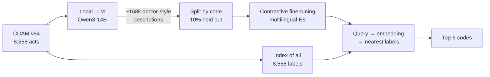

# Assistant de codage CCAM

**Free-text French act description → the 5 most likely CCAM codes.**

Doctors describe procedures in their own words, such as *"PTH G voie postérieure"*, *"chole coelio"* or
*"exérèse kyste sébacé du dos"*. Billing requires one of **8,558 official CCAM codes**, each with a long
administrative label (*"Remplacement de l'articulation coxofémorale par prothèse totale"*). Keyword
search fails because the two vocabularies barely overlap.

This project fine-tunes a multilingual sentence-embedding model (E5) to map doctor-style descriptions
onto the official labels. There is no hand-labelled data: the training set is ~168k descriptions
written by a local LLM. The model is compared against keyword search (BM25) on codes it **never saw
during training**.

| On codes never seen in training | Keyword search (BM25) | **Fine-tuned E5** |
|---|---|---|
| Correct code in top 5 | 75.7% | **97.1%** |
| Correct code at #1 | 47.7% | **79.6%** |
| Top 5, acronym/shorthand-style descriptions | 73.0% | **95.6%** |

> These numbers come from LLM-written test descriptions, so they are an upper bound. See
> [Evaluation](#evaluation-and-its-limits) for what they do and don't show.

---

## How it works



1. **Catalogue** ([`prepare.py`](ccam_ai/prepare.py)): every CCAM act with its label, abbreviated
   label, chapter, parent heading, and up to 8 *sibling* acts (same heading). Each act also gets its
   2024 national hospital volume (ATIH Open CCAM).

2. **Synthetic training data** ([`generate.py`](ccam_ai/generate.py)): Qwen3-14B (AWQ, via vLLM on a
   16 GB GPU) writes descriptions for every act, in two passes:
   - **Pass 1, ~14 per act:** short notes, report sentences, patient context, rushed typing without
     accents. The prompt lists the **sibling acts "not to confuse with"**, so descriptions keep what
     tells near-identical codes apart (approach, size, number, technique).
   - **Pass 2, 6 per act:** acronym- and condition-style notes, added after error analysis (below).
     The prompt is given the acronyms that really apply to that act (*PTH*, *sonde JJ*, *FOGD*,
     *RTUP*…), reverse-looked-up from a curated abbreviation list, plus examples that name the
     condition instead of the procedure (*kyste sébacé*, *lipome*, *naevus*).

3. **Splits** ([`split.py`](ccam_ai/split.py)): 10% of codes (855) are **held out entirely**. The
   model never sees any description of them, but they stay in the search index, so they act as
   distractors and as targets.

4. **Fine-tuning** ([`train.py`](ccam_ai/train.py)): sentence-transformers with
   `CachedMultipleNegativesRankingLoss`:
   - every other code in a 128-pair batch is a negative, plus one **hard negative** drawn from the
     target's sibling acts;
   - batches never contain the same code twice, to avoid false negatives;
   - 3 epochs, about 40 min on an RTX 5060 Ti.

5. **Query-time abbreviation expansion** ([`abbrev.py`](ccam_ai/abbrev.py)): ~90 unambiguous French
   medical acronyms, expanded into the CCAM's own vocabulary (e.g. *IRM* → *remnographie*, *TDM* →
   *scanographie*, *JJ* → *endoprothèse urétérale*). The original text is kept and the expansion is
   appended. Ambiguous acronyms (*PAC*, *AG*, *laparo*) are deliberately left out.

6. **Demo** ([`app/app.py`](app/app.py)): Gradio app showing the model's top 5 next to keyword search
   for the same query.

---

## Results

All methods search the full index of 8,558 codes. *acc@k* is the share of queries whose correct code
appears in the top *k*.

### Codes never seen in training (`test_unseen`: 11,732 descriptions, 855 codes)

| Method | acc@1 | acc@3 | acc@5 | acc@10 | MRR@10 |
|---|---|---|---|---|---|
| BM25 keyword search | 47.7% | 69.2% | 75.7% | 82.3% | 0.597 |
| multilingual-E5-base, no fine-tuning | 56.8% | 76.6% | 82.6% | 88.3% | 0.679 |
| sentence-CamemBERT-base, no fine-tuning | 37.6% | 54.7% | 61.6% | 70.7% | 0.480 |
| CamemBERT, fine-tuned | 76.0% | 92.0% | 95.3% | 97.6% | 0.844 |
| E5, fine-tuned (v1, pass-1 data) | 79.7% | 94.3% | 96.8% | 98.6% | 0.872 |
| **E5, fine-tuned (v2, pass-1 + pass-2 data)** | **79.6%** | **94.6%** | **97.1%** | **98.9%** | **0.873** |

### Same codes, acronym/condition-style descriptions (`test_unseen_jargon`: 5,105 descriptions, 855 codes)

| Method | acc@1 | acc@3 | acc@5 | acc@10 | MRR@10 |
|---|---|---|---|---|---|
| BM25 keyword search | 45.4% | 66.3% | 73.0% | 79.7% | 0.573 |
| BM25 + abbreviation expansion | 47.0% | 67.8% | 74.6% | 81.6% | 0.588 |
| multilingual-E5-base, no fine-tuning | 50.8% | 70.4% | 77.0% | 83.3% | 0.619 |
| E5 v1 | 73.0% | 89.2% | 92.8% | 96.1% | 0.818 |
| E5 v1 + abbreviation expansion | 73.6% | 89.6% | 93.4% | 96.4% | 0.823 |
| **E5 v2 + abbreviation expansion** | **77.2%** | **92.8%** | **95.7%** | **98.1%** | **0.854** |

<details>
<summary>Codes seen in training (<code>test_seen</code>, optimistic)</summary>

Held-out descriptions of training codes. They come from the same LLM call as that code's training
descriptions, so expect them to be easier.

| Method | acc@1 | acc@5 | MRR@10 |
|---|---|---|---|
| BM25 | 44.9% | 73.5% | 0.573 |
| CamemBERT fine-tuned | 79.2% | 96.9% | 0.870 |
| E5 v1 | 83.6% | 98.6% | 0.902 |
| E5 v2 | 84.6% | 98.8% | 0.909 |

Full tables, including every variant: [`results/metrics.md`](results/metrics.md).
</details>

**Takeaways**

- **Fine-tuning matters more than the base model.** Zero-shot E5 is only 7 points better than BM25;
  fine-tuned, it is 21 points better.
- **The model generalises to codes it never saw:** top-5 is 97.1% on unseen codes vs 98.8% on seen
  ones. It learned how medical language maps onto CCAM labels, not a list of answers.
- **E5 beats CamemBERT** on the same training data (v1) by 1.5 points top-5 and 3.7 points top-1 (278M vs 110M parameters; both
  run comfortably on CPU), so it is the model shipped in the demo.
- **The pass-2 data fixed a real weakness without hurting the rest:** +2.8 points top-5 on
  acronym-style queries, and no drop on the original test set (identical files, verified by checksum).

---

## Error analysis: what the synthetic numbers hid

After v1 scored 96.8% top-5, I tried it on short notes written the way doctors actually type them,
and it got only about half right:

| Query | v1 result |
|---|---|
| *PTH G voie postérieure* | hip replacement not in the top 10 (spine codes instead) |
| *pose de sonde JJ* | read *JJ* as *jéjunal*, not the ureteral stent |
| *exérèse naevus joue* | nose/lip repairs |

The cause was in the training data, not the model. Among 117,286 pass-1 descriptions:

- **"PTH" appeared 0 times.** The hip-replacement code got *"prothèse totale de hanche"*, never the
  acronym every orthopaedic surgeon writes. "Sonde JJ" also appeared 0 times. The prompt told the LLM
  to use only abbreviations it was sure of, and it became too cautious.
- **Doctors name the condition, the CCAM names the procedure.** A doctor writes *kyste sébacé*,
  *lipome* or *naevus*; the CCAM says *lésion souscutanée susfasciale de moins de 3 cm*.
  *"Kyste sébacé"* appeared 0 times.

**The fix:** a second generation pass focused on acronyms and named conditions, with the right
acronyms injected per code. Without them, Qwen-14B wrote *"FGD"* for FOGD and the English *TURP*
instead of RTUP. Query-time abbreviation expansion was added as a safety net.

### Spot check: 30 hand-written shorthand queries

Correct code in the top 5 ([`spotcheck.py`](ccam_ai/spotcheck.py), [`results/spotcheck.txt`](results/spotcheck.txt)):

| BM25 | BM25 + abbrev | E5 v1 | E5 v1 + abbrev | E5 v2 | **E5 v2 + abbrev** |
|---|---|---|---|---|---|
| 6/30 | 22/30 | 17/30 | 24/30 | 25/30 | **28/30** |

| Query | Expected | v1 rank | v2 + abbrev rank |
|---|---|---|---|
| PTH G voie postérieure pour coxarthrose | NEKA020 | – | 2 |
| kyste sébacé du dos 2 cm | QZFA002 | 5 | **1** |
| exerese naevus joue 1cm suture simple | QZFA036 | 6 | 2 |
| hernie inguinale G sous coelio avec plaque | LMMC002 | – | 3 |
| FOGD | HEQE002 | 6 | **1** |
| RTUP | JGFE023 | – | **1** |
| pose de sonde JJ à droite sous AG | JCLE002 | – | 7 ✗ |
| pose de port-à-cath | EBLA003 | – | 6 ✗ |

The two remaining misses:
- In *"sonde JJ"*, the word *sonde* still pulls in gastric and jejunal tubes.
- *Port-à-cath* is described in CCAM wording that shares almost nothing with the colloquial name.

> **Caveat:** I wrote both these queries and the abbreviation list, so this is a sanity check, not
> a benchmark. In particular, the BM25 + abbrev score is inflated.

---

## Evaluation and its limits

- **Every test description was written by an LLM**, in the same style as the training data. The
  `test_unseen` numbers are honest about *unseen codes*, but not about *real clinical text*, which is
  longer, messier and often describes several acts at once.
- **v2 is partly in-distribution on `test_unseen_jargon`:** it trained on descriptions in that style
  (for other codes). Its gain there is real but expected.
- **What would settle it:** a gold set of real, anonymised descriptions with the code a professional
  coder chose. Put it in `data/eval/gold.csv` (columns `query,code`, see
  [`gold.example.csv`](data/eval/gold.example.csv)), and `evaluate.py` adds it to every table
  automatically.
- **Scope:** this is a suggestion tool, not an autocoder. It returns candidate *acts*. Activity and
  phase codes, modifiers, association rules and multi-act reports are out of scope.

---

## Run it

Requirements: Python 3.12, an NVIDIA GPU with 16 GB for generation (training needs less; inference
runs on CPU). Exact versions are in [`requirements.txt`](requirements.txt).

```bash
python -m venv .venv && .venv/bin/pip install -r requirements.txt

# put the CCAM Excel file from ameli.fr (any *ccam*.xlsx) and, optionally, ATIH's
# open-ccam-national.csv from data.gouv.fr in data/raw/, then:
.venv/bin/python -m ccam_ai.prepare                       # -> data/processed/codes.jsonl
.venv/bin/python -m ccam_ai.generate                      # pass 1, resumable
.venv/bin/python -m ccam_ai.generate --mode jargon --n 6  # pass 2, resumable
.venv/bin/python -m ccam_ai.split
.venv/bin/python -m ccam_ai.train --base intfloat/multilingual-e5-base --out models/e5-base-ccam-v2
.venv/bin/python -m ccam_ai.evaluate                      # -> results/metrics.md
.venv/bin/python -m ccam_ai.spotcheck models/e5-base-ccam-v2

.venv/bin/python app/app.py                               # demo on http://localhost:7860
```

[`run_v2.sh`](run_v2.sh) chains pass 2 → split → training → evaluation → spot check (about 1h40 on an
RTX 5060 Ti 16 GB).

Useful generation flags:
- `--limit 20 --print` previews outputs without saving.
- `--gpu-mem` leaves room for the desktop on a shared GPU.

## Project layout

```
ccam_ai/
  common.py      paths, I/O, French tokenisation helpers
  prepare.py     CCAM Excel -> codes.jsonl (labels, hierarchy, siblings, volumes)
  generate.py    vLLM generation of doctor-style descriptions (pass 1 + jargon pass)
  split.py       train / val / test_seen / test_unseen / test_unseen_jargon
  train.py       contrastive fine-tuning with sibling hard negatives
  retrievers.py  BM25 baseline + dense retriever
  abbrev.py      medical abbreviation expansion + per-code acronym hints
  evaluate.py    acc@k / MRR tables for every method and test set
  spotcheck.py   hand-written shorthand queries
app/app.py       Gradio demo
results/         metrics.md, metrics.json, spotcheck.txt
```

## Data sources

- **CCAM nomenclature**, version 84.00: the official list of French medical acts (Assurance Maladie).
- **Act volumes:** ATIH, *Open CCAM – National*, 2024 (data.gouv.fr). Used for catalogue statistics.
- **Base models:**
  [`intfloat/multilingual-e5-base`](https://huggingface.co/intfloat/multilingual-e5-base),
  [`dangvantuan/sentence-camembert-base`](https://huggingface.co/dangvantuan/sentence-camembert-base),
  [`Qwen/Qwen3-14B-AWQ`](https://huggingface.co/Qwen/Qwen3-14B-AWQ) (generation only).

Raw data, generated descriptions and model weights are not stored in this repository: download
the CCAM file from ameli.fr (*CCAM en ligne → Téléchargement*) and rebuild the rest with the
pipeline above.

## Licence

Code: [MIT](LICENSE). The CCAM nomenclature and the ATIH data belong to their publishers and are
not redistributed here.

---

*Decision-support prototype. Final coding remains the responsibility of the practitioner and the
medical information department (DIM).*
